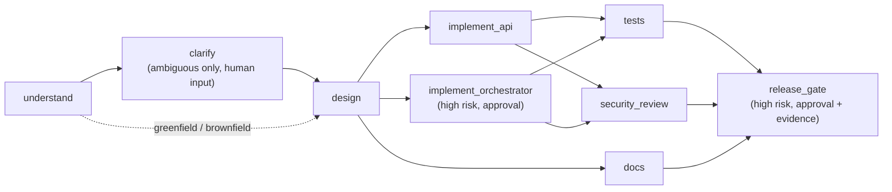

<<<<<<< HEAD
# Technical Documentation

## Contents

1. [Engineering summary](#1-engineering-summary)
2. [Requirement normalization](#2-requirement-normalization)
3. [Assumptions](#3-assumptions)
4. [Architecture](#4-architecture)
5. [Orchestration model](#5-orchestration-model)
6. [Governance controls](#6-governance-controls)
7. [Observability and metrics](#7-observability-and-metrics)
8. [Scenarios](#8-scenarios)
9. [Risks and failure scenarios](#9-risks-and-failure-scenarios)
10. [Testing approach](#10-testing-approach)
11. [Key decisions and trade-offs](#11-key-decisions-and-trade-offs)
12. [Limitations](#12-limitations)

## 1. Engineering summary

**What was built.** A URL-shortening service (create, redirect, click analytics) and a
governed workflow orchestrator. The orchestrator takes a requirement through
requirements, clarification, design, implementation, validation, documentation and
release as a dependency graph, with human gates, fail-closed evidence checks, audit
lineage, bounded retries, rollback, crash recovery and reliability metrics.

**Plan and rationale.** The assignment names orchestration as the critical
differentiator, so most of the effort went into making the governance properties real
and testable rather than into agent sophistication. The agents are deterministic: they
inspect the repository, run its test suite in a subprocess, probe the real validation
schema, and write evidence. This lets every governance claim be proven by a test or a
reproducible run instead of asserted.

**Artifacts.**

| Artifact | Location |
|---|---|
| Service and orchestrator source | `app/`, `orchestrator/` |
| API schema | `/docs` (OpenAPI) on the running service; tables in `README.md` |
| 58 automated tests | `tests/` |
| Real scenario runs with full audit trails | `docs/scenario-runs/`, regenerated by `scripts/run_scenarios.py` |
| Per-run evidence files | `.agentic-artifacts/<run_id>/` (requirements, clarifications, architecture, test evidence, security review, release gate) |
| Verification record and change log | `SUBMISSION_STATUS.md` |

**Validation.** Every row in the risk table (§9) points to the test that proves its
mitigation, or is marked as not mitigated. The scenario runs show gates, lineage and
parallel execution on real data.

**Assumptions and limitations** are in §3 and §12. The most important: agents do not
write code, approver identity is not authenticated, and orchestration state is
single-process.

## 2. Requirement normalization

The brief asks for "a URL shortener service with core APIs, analytics, and reliability
features," built through "an agentic execution model" with governance. Turned into an
engineering problem:

> Provide an HTTP service that maps public web URLs to short codes and redirects to them,
> counting clicks, and a workflow engine that carries an engineering requirement to a
> release decision through a dependency graph in which agents act only inside defined
> gates and humans make every high-impact decision, with every step traceable.

### Functional requirements

| ID | Requirement | Verified by |
|---|---|---|
| F1 | Create a short code for an http/https URL, optionally with a custom code | `test_shorten_redirect_and_analytics`, `test_custom_code_conflict` |
| F2 | Redirect a known code to its destination; 404 for an unknown one | `test_shorten_redirect_and_analytics`, `test_unknown_code_is_404` |
| F3 | Report click count, creation time and last click per code | `test_shorten_redirect_and_analytics` |
| F4 | Run a requirement through a per-scenario task graph | `test_all_scenarios_create_dependency_aware_plans` |
| F5 | Pause for human clarification when the requirement is ambiguous | `test_ambiguous_run_pauses_for_clarification` |
| F6 | Pause for human approval before high-impact tasks | `test_approval_gate_and_resume` |
| F7 | Re-plan when the requirement changes, invalidating prior approvals | `test_replan_requires_fresh_approval_for_new_generation` |
| F8 | Roll back and safe-stop a run | `test_rollback_records_actor_and_reason`, `test_rollback_guards` |
| F9 | Report success rate, retries, rollbacks, MTTR and latency | `test_transient_failure_retries_and_records_mttr` |

### Non-functional requirements

| ID | Requirement | How it is met |
|---|---|---|
| N1 | Untrusted input is validated at the edge | Public-host policy, reserved codes, code format (§9) |
| N2 | Concurrent requests never corrupt state or return 500 | DB constraint as source of truth; per-run execution lock |
| N3 | Failures are visible, bounded and recoverable | Bounded retries, fail-closed gates, `interrupted` state, crash recovery |
| N4 | Every decision is traceable to a person and a plan version | Generation-tagged decisions; append-only audit trail |
| N5 | Runs locally with no external services | SQLite and a deterministic agent registry |

### Ambiguities in the brief and how they were resolved

| Ambiguity | Interpretation chosen | Why |
|---|---|---|
| What an "agent" is | A deterministic handler per task | Governance can be tested exactly; see §11 |
| What "rollback" reverts | Workflow state only | No deployment target exists in a local prototype |
| What "MTTR" measures without incidents | Time from a task's first failure to its recovery | The closest measurable recovery event |
| How much "analytics" | Count, last click, and stored raw events (user agent, referrer) | Raw events allow richer reports later without schema changes |
| Which redirect status | 302 | Every click reaches the service and is counted (§11) |

### Out of scope

Authentication and user ownership, rate limiting, link expiration, custom domains, URL
reputation screening, multi-instance deployment, and agents that modify source code.

## 3. Assumptions

- The service runs as **one process**. Orchestration state is held in memory and
  snapshotted to SQLite after every change.
- **Approvers are trusted to report their own name.** Separation of duties compares
  names; there is no identity provider.
- Destinations are **public web pages** reached over http or https. Internal and
  private addresses are refused by design.
- **Losing a click is acceptable; failing a redirect is not.** When analytics cannot be
  written, the redirect still happens.
- A **failing test suite may be flaky**, so it gets one retry. A gate refusal is a
  decision based on evidence and is never retried.
- `tests/test_url_shortener.py` is the regression suite the `tests` agent runs. The full
  suite is run by the operator or CI.
- The **evaluator runs locally** on Python 3.11+ with nothing else installed.

## 4. Architecture

```text
Client
  ├── URL API (app/main.py) ── URLService ── SQLiteStore ── url_shortener.db
  └── Workflow API (orchestrator/api.py)
        └── WorkflowEngine (orchestrator/engine.py)
              ├── Planner ─────────── builds a per-scenario task DAG
              ├── Gates ───────────── clarification · approval · evidence (fail-closed)
              ├── AgentRegistry ───── deterministic agents, run in worker threads
              ├── Audit + decisions ─ append-only lineage on the run
              └── WorkflowRepository ─ workflow_state.db (runs, metrics) + crash recovery
```

| Component | Responsibility |
|---|---|
| `app/schemas.py` | Request validation: public-host policy, reserved codes, code format |
| `app/service.py` | Code generation and uniqueness (the DB constraint is the source of truth); redirects that survive analytics failures |
| `app/store.py` | Parameterized SQLite access; maps constraint violations to domain errors |
| `orchestrator/planner.py` | Builds the task DAG for a scenario |
| `orchestrator/engine.py` | Scheduling, gates, retries, re-planning, rollback, interruption, metrics, locking |
| `orchestrator/agents.py` | One handler per task; writes evidence artifacts |
| `orchestrator/persistence.py` | Snapshot persistence and interrupted-task recovery |
| `scripts/run_scenarios.py` | Runs the scenarios end to end and writes their audit trails |

## 5. Orchestration model

### Task graph



`design` fans out into three parallel branches. `tests` and `security_review` wait for
both implementation tasks to finish, and `release_gate` waits for all three validation
branches. The graph is checked for unknown dependencies and cycles (Kahn's algorithm)
before every execution.

### Execution loop

Each iteration:

1. Propagate failures: any task whose dependency failed, was blocked or was rolled back
   becomes `blocked`, and is never silently skipped.
2. Collect ready tasks: `pending`/`ready` with every dependency `succeeded`.
3. Pass each through its gates. A task needing input parks at `waiting_input`; a task
   needing approval without a current-generation approval parks at `waiting_approval`.
4. Run the remaining tasks concurrently with `asyncio.gather`. Each agent runs in a
   worker thread (`asyncio.to_thread`) on a deep-copied snapshot of the context, so
   branches cannot race on shared state and blocking work does not stall the API server.
   Outputs are merged back on the event loop.
5. Persist after every state change.

The loop ends when every task has reached a final state, when progress needs a human,
or when a gate stops the run.

### States

Task: `pending → ready → running → succeeded | failed | blocked`, plus `waiting_input`,
`waiting_approval` and `rolled_back`.

Run: `created → running → waiting_input | waiting_approval | interrupted → … →
succeeded | failed | blocked | rolled_back`. Final runs cannot be changed; `execute` on
them does nothing. `replan` is the only way to reopen a run.

`interrupted` means the engine itself failed (a database write, a process crash) rather
than an agent. Any `running` tasks are returned to `ready`, an audit event is recorded,
and `POST /resume` continues the run. Rollback and replan remain available.

Only one execution at a time is allowed per run (an `asyncio.Lock` per run).

## 6. Governance controls

| Requirement | Implementation |
|---|---|
| Entry/exit gates | Entry: dependency check plus clarification/approval gates. Exit: the release gate checks test, security and docs evidence and **fails closed** (`GateBlocked`, not retried, run ends `blocked`). |
| Human approval for high-impact work | `implement_orchestrator` and `release_gate` require an approval from the current plan generation. |
| Separation of duties | The approver must differ from `requested_by`. Attempts are refused and audited as `policy_violation`. |
| Informed approval | The `approval_requested` event includes upstream evidence (test pass/exit code, findings, artifact paths). |
| Approval is necessary but not sufficient | A human approval cannot override failing evidence; see `docs/scenario-runs/04-gate-blocked.md`. |
| Clarification before design | The ambiguous scenario adds a `clarify` node. Answers must cover every question and are recorded as decisions. |
| Bounded retries | `max_retries=1` with exponential backoff. Retryable (`AgentError`) and non-retryable (`GateBlocked`) failures are distinct. |
| Rollback / safe-stop | Rollback marks implementation and release tasks `rolled_back`, ends the run, and records actor, reason and reverted tasks. It is refused while running, when already rolled back, or when nothing has run. Approval denial is a safe-stop (`blocked`). |
| Change control | `replan` rebuilds the plan, starts a new generation, and clears answers. Old approvals stay in lineage but cannot authorize the new plan. |
| Demo bypass | `auto_approve` returns 403 unless `ALLOW_DEMO_AUTO_APPROVE` is set. Bypasses are recorded under `demo-auto-approval`. |

## 7. Observability and metrics

Every state change is appended to `run.audit` with a timestamp, task id and details.
Human decisions (approvals and clarifications) are kept separately in `run.decisions`,
tagged with the plan generation. Agents write evidence to `<artifacts>/<run_id>/*.json`.

`GET /api/workflows/metrics/summary`:

| Metric | Definition |
|---|---|
| `success_rate` | `succeeded / (succeeded + failed + blocked)`. Counted once per plan generation; runs still in progress are excluded, so it is always within [0, 1]. |
| `retries`, `retry_rate_per_run` | Scheduled retries, total and per created run |
| `rollbacks`, `rollbacks_per_run` | Rollback actions, total and per created run |
| `mttr_ms` | Mean time from a task's first failed attempt to its later success |
| `average_execution_ms` | Agent execution time per finished run, excluding human wait time |
| `average_lead_time_ms` | Wall clock from plan start to final outcome, including human wait time |

Separating execution time from lead time matters: a slow run caused by a reviewer at
lunch is a different problem from a slow agent.

## 8. Scenarios

Each scenario below has a real run in `docs/scenario-runs/` showing the final task
states, every human decision and the complete audit trail. To reproduce:
`py scripts/run_scenarios.py`.

### Greenfield: new URL shortener with analytics

Evidence: [`01-greenfield.md`](docs/scenario-runs/01-greenfield.md)

- **Breakdown:** the eight-node graph in §5. After design, the API, orchestrator and
  docs branches run in parallel.
- **Orchestration:** pauses for approval at `implement_orchestrator` (approved by
  `marcus`), then at `release_gate` with test and security evidence attached (approved by
  `lena`).
- **Validation:** the `tests` agent runs `pytest tests/test_url_shortener.py` in a
  subprocess and records the exit code and output. The `security_review` agent sends
  known-bad destinations through the real `ShortenRequest` schema and confirms reserved
  codes and parameterized SQL. The release gate requires all three evidence sources.

### Brownfield: backward-compatible enhancement with a requirement change

Evidence: [`02-brownfield.md`](docs/scenario-runs/02-brownfield.md)

- **Breakdown:** the same graph. The `understand` and `design` tasks carry an explicit
  requirement to keep existing API contracts and plan a backward-compatible change.
- **Orchestration:** after implementation is approved, the requirement changes before
  release. `replan` creates generation 1. The generation-0 approval stays in the lineage
  but cannot authorize the new plan, so the run pauses at `implement_orchestrator` again.
  This is change control in action.
- **Validation:** the existing test suite is the regression check that existing links
  still resolve.
- **Limitation:** impact analysis is not a separate node and does not yet list affected
  modules. An `impact_analysis` node before `design` is the recommended next step.

### Ambiguous: "make links short"

Evidence: [`03-ambiguous.md`](docs/scenario-runs/03-ambiguous.md)

- **Breakdown:** a `clarify` node is inserted between `understand` and `design`.
- **Orchestration:** `understand` raises three open questions. The run pauses at
  `waiting_input`, and design does not start. A partial answer is refused (409). The
  complete answers become generation-tagged decisions and appear in the design output
  (`resolved_clarifications`). The requester then tries to approve her own run and is
  refused.
- **Re-planning:** changing the requirement clears earlier answers and pauses the run for
  clarification again (`test_replan_invalidates_previous_clarifications`).

### Validation under failure: the release gate fails closed

Evidence: [`04-gate-blocked.md`](docs/scenario-runs/04-gate-blocked.md)

A security regression is injected. The approval request carries the failing evidence;
the approver approves anyway; the evidence gate still refuses, is not retried, and the
run ends `blocked`. The human approves the release, but the evidence has to agree.

## 9. Risks and failure scenarios

| # | Failure scenario | Impact if unhandled | Mitigation | Proven by |
|---|---|---|---|---|
| 1 | Agent hits a transient error | Run fails on a blip | One retry with exponential backoff; recovery time feeds MTTR | `test_transient_failure_retries_and_records_mttr` |
| 2 | Agent fails persistently | Downstream work runs on a broken base | Task `failed` after retries; descendants `blocked`; independent branches still finish | `test_retry_exhaustion_fails_run_and_blocks_descendants` |
| 3 | Test suite hangs | Run and API stall indefinitely | 60 s subprocess timeout → retryable failure → run `failed` | `test_hung_test_suite_times_out_and_fails_run` |
| 4 | Security check regresses | Unsafe release | Gate fails closed; `GateBlocked` is not retried | `test_release_gate_fails_closed_on_blockers`, scenario 04 |
| 5 | Approver signs off without reading evidence | Rubber-stamped release | Evidence attached to the request; the evidence gate still applies after approval | `test_approval_request_carries_upstream_evidence`, scenario 04 |
| 6 | Requester approves their own change | No independent review | Refused and audited as `policy_violation` | `test_requester_cannot_self_approve` |
| 7 | Client skips the gates with `auto_approve` | Governance bypass | 403 unless the operator sets `ALLOW_DEMO_AUTO_APPROVE`; bypasses are labelled in lineage | `test_api_rejects_auto_approve_without_demo_flag` |
| 8 | Requirement changes after approval | Approval covers work nobody reviewed | Approvals are tied to the plan generation; replan requires fresh ones | `test_replan_requires_fresh_approval_for_new_generation`, scenario 02 |
| 9 | Ambiguous request built on guesses | Wrong thing built | `clarify` gate before design; partial answers refused | `test_ambiguous_run_pauses_for_clarification` |
| 10 | Process crashes mid-task | Task falsely marked done, or lost | On restart, `running` tasks → `ready`, run → `interrupted`, recovery audited | `test_process_crash_mid_task_recovers_on_restart` |
| 11 | DB write fails mid-run | Run stuck `running`; no rollback possible | Run → `interrupted` and resumable; rollback/replan stay available | `test_db_failure_mid_run_leaves_run_resumable` |
| 12 | Two approvals arrive at once | Same work executed twice; double-counted metrics | Per-run execution lock | `test_concurrent_execute_calls_are_serialized` |
| 13 | Invalid plan (cycle) | Deadlock or infinite loop | Graph validated before execution; nothing runs | `test_cyclic_plan_is_rejected_before_execution` |
| 14 | Rollback misused | Inflated metrics; misleading audit | Refused while running, if already rolled back, or if nothing ran | `test_rollback_guards` |
| 15 | Short link to internal infrastructure | Phishing or pivot to metadata endpoints | Public-host policy (loopback, private, link-local, CGNAT, mapped IPv6, `.local`/`.internal`) | `test_reject_non_public_destinations` (15 cases) |
| 16 | Two clients claim the same custom code | 500 error or silent overwrite | Insert-first; constraint violation → 409 | `test_concurrent_custom_code_claims_yield_one_winner` |
| 17 | Random code space is crowded | Unbounded retry loop | 5 attempts, then 503 | `test_generated_code_collision_retries_then_503` |
| 18 | Custom code shadows an app route | Link that can never resolve | Reserved-code list | `test_reserved_custom_codes_rejected` |
| 19 | Analytics write fails (locked DB) | User sees 500 instead of a redirect | Redirect proceeds; failure logged; clicks undercounted | `test_redirect_survives_analytics_write_failure` |
| 20 | Approver never responds | Run waits forever | **Not mitigated.** The run's status is visible, but there is no timeout or escalation | — |
| 21 | Several uvicorn workers | Each worker holds diverging state | **Not mitigated.** Run a single worker; see §12 | — |
| 22 | Public DNS name resolving to a private IP | Rule 15 bypassed | **Not mitigated.** Names are not resolved at creation time | — |

## 10. Testing approach

58 tests, run in an isolated temp directory (`tests/conftest.py`):

- **API behaviour:** shorten, redirect, analytics, 404, 409, and 503 when codes run out.
- **Validation:** 15 non-public destinations rejected, public ones accepted, and
  reserved codes rejected.
- **Concurrency:** 8 threads claim one custom code and exactly one wins; concurrent
  executions of a run are serialized.
- **Governance:** approval and clarification gates, denial safe-stop, self-approval
  refusal, fresh approvals after replan, release gate failing closed.
- **Failure injection:** transient and persistent agent failures, a hung test suite, a
  DB write failure mid-run, a process crash mid-task, a cyclic plan, and an analytics
  write failure during a redirect.
- **Execution:** parallel branches overlap in time, and the event loop stays responsive
  during agent work.

Most orchestration tests swap the pytest subprocess for canned evidence (`FastAgents`)
so they run fast and give the same result every time. Real-subprocess coverage comes
from the original engine tests and from `scripts/run_scenarios.py`.

The risk table doubles as the test plan: a failure scenario is either backed by a named
test or explicitly marked not mitigated.

## 11. Key decisions and trade-offs

- **Deterministic agents over LLM agents.** The governance properties can be tested and
  reproduced exactly. The cost is that implementation stages inspect code rather than
  write it.
- **Gates fail closed, and approval is not sufficient on its own.** A gate that reports
  "not ready" but still succeeds is worse than having no gate, because it creates false
  confidence.
- **Retryable versus non-retryable failures.** Retrying a gate that refused based on
  evidence wastes time and inflates the retry count. The cost: a real (non-flaky) test
  failure is retried once before failing.
- **Redirect availability over analytics accuracy.** The redirect is the product;
  losing a click count is cheaper than failing a user's navigation.
- **Engine failures are separate from agent failures.** An `interrupted` state keeps a
  run recoverable without pretending the problem was in the task.
- **Snapshot persistence (one JSON payload per run).** Simple and atomic for each run.
  The cost is that audit events can't be queried across runs without loading every run.
- **SQLite.** Zero setup. The cost is a single writer and a single process.
- **302 redirects.** Browsers don't cache them, so every click is counted. A 301 would
  reduce load but undercount clicks.
- **Destination policy at the API edge.** Blocks obvious abuse cheaply. It does not
  resolve DNS.

## 12. Limitations

- Approver identity is self-asserted; there is no authentication.
- Approvals never time out and are never escalated.
- No rate limiting, abuse quotas or URL reputation/phishing screening.
- Orchestration state is in-memory per process with SQLite snapshots; running several
  workers would give each its own diverging copy. Production would need a shared store
  with compare-and-set or a durable queue.
- Recovery makes interrupted tasks retryable but does not guarantee each side effect
  happens exactly once.
- Rollback reverts workflow state only, not Git changes, migrations or deployments.
- Re-planning rebuilds the whole plan; it does not yet invalidate only the tasks
  downstream of a changed output.
- Brownfield impact analysis is described in task text, not implemented as a node.
- MTTR measures task-level retry recovery, not incident lifecycle.
- No load testing.
=======
# Technical Documentation

## 1. Scope

This document describes the URL-shortener API and the governed
workflow-orchestration prototype. The workflow uses deterministic local
adapters to demonstrate task orchestration, approval gates, persistence,
and auditability. It should not be represented as an autonomous LLM
coding agent.

## 2. Components

### URL shortener (`app/`)

The FastAPI application provides URL creation, short-code redirection,
and analytics endpoints. URL records are stored in SQLite.
`DATABASE_PATH` selects the database file and defaults to
`./url_shortener.db`.

Responsibilities include request validation, short-code creation and
lookup, redirects, analytics, and persistence. For authoritative
request/response schemas, inspect route definitions or the running
`/docs` page.

### Workflow orchestration (`orchestrator/`)

The orchestrator manages workflow runs, task states, approval decisions,
audit events, persistence, and recovery. Task/agent adapters are
deterministic local implementations and do not autonomously edit
arbitrary source files, create pull requests, or deploy services.

### Tests (`tests/`)

The test suite covers implemented behavior. Run the checks in Section 8
after making changes.

## 3. HTTP API

### Create a short URL

`POST /api/shorten`

The client submits a destination URL as JSON. The service validates the
input and returns the response defined by the implementation. Example
request:

``` json
{
  "url": "https://example.com/path"
}
```

Confirm exact field names and response properties in `/docs`.

### Redirect

`GET /{short_code}`

A known code redirects to the stored destination. Unknown-code behavior
is determined by the application.

### Analytics

`GET /api/analytics/{short_code}`

Returns analytics recorded for the selected code. Consult the response
model for exact fields and semantics.

## 4. Workflow lifecycle

A typical workflow run follows these stages:

1.  Create a run and its configured task list.
2.  Determine which tasks are eligible.
3.  Execute eligible tasks using local deterministic adapters.
4.  Record task state transitions and audit events.
5.  Pause when a human-approval gate is reached.
6.  Resume after the required decision is recorded.
7.  Persist the final run and update aggregate metrics.

The exact task names and sequence are defined in the orchestrator
configuration. The demonstrated end-to-end run required approvals at
`implement_orchestrator` and `release_gate`.

### Approval gates

Approval gates stop progression at configured checkpoints until a
decision is recorded. An approval in this prototype is a workflow
decision; it is not proof of a production deployment, external code
review, or source-code modification.

### Audit events

The audit trail captures workflow events and decisions to support
inspection of a run. It is not a tamper-proof compliance log or a
replacement for centralized production audit infrastructure.

## 5. Persistence and recovery

### Workflow database

The workflow repository uses SQLite. `WORKFLOW_DB_PATH` configures the
database path; the default is `./workflow_state.db`. Workflow runs,
audit events, decisions, and aggregate workflow metrics persist in
SQLite.

### Interrupted tasks

On loading persisted runs, tasks marked `RUNNING` are reset to `READY`
with a recovery message, and an `execution_recovered` audit event is
recorded. A workflow saved as running is returned to a recoverable
created state with a recovery audit entry.

This allows safe retry at the workflow-state level. It does not
guarantee exactly-once side effects. Any future external side effects
should use idempotency keys and reconciliation.

### URL database

`DATABASE_PATH` configures the URL database and defaults to
`./url_shortener.db`. Database files and SQLite sidecar files are local
runtime state and should not be committed.

## 6. Configuration

  -----------------------------------------------------------------------
  Setting                 Purpose                 Default
  ----------------------- ----------------------- -----------------------
  `DATABASE_PATH`         URL-shortener SQLite    `./url_shortener.db`
                          database

  `WORKFLOW_DB_PATH`      Workflow state and      `./workflow_state.db`
                          metrics database
  -----------------------------------------------------------------------

Check `.env.example` and source code for the complete supported
configuration. Do not assume additional environment variables exist
without verifying them.

## 7. Local setup

On Windows PowerShell:

``` powershell
py -m venv .venv
.\.venv\Scripts\Activate.ps1
py -m pip install --upgrade pip
py -m pip install -e ".[dev]"
```

If the development extra is not declared, install the dependencies and
tools specified in `pyproject.toml`. Copy `.env.example` to `.env` only
if required and never commit `.env`.

## 8. Tests and checks

Run from the repository root:

``` powershell
py -m ruff check .
py -m pytest -q
```

Previously verified in this project context: Ruff passed and pytest
reported 13 passing tests. A Starlette/httpx deprecation warning was
observed but did not fail the test run. Rerun the checks before
submission.

Recommended further tests include concurrent short-code creation,
analytics update concurrency, process-restart recovery,
retry/idempotency behavior, malformed URLs, unknown short codes, and
persistence failures.

## 9. Limitations and production hardening

-   No demonstrated authentication or per-user URL ownership controls.
-   No demonstrated rate limiting or abuse quotas.
-   No URL reputation/phishing/malware screening.
-   No evidence of production-scale load testing.
-   Metrics are prototype reliability counters, not full SLO telemetry;
    MTTR is not derived from a complete incident lifecycle.
-   Rollback records workflow/audit intent and does not revert Git or a
    live deployment.
-   SQLite is simple for local use but needs a deployment strategy for
    high-throughput, multi-instance operation.
-   Deterministic workflow adapters do not autonomously modify source
    code.
-   Recovery does not provide distributed locking or exactly-once
    execution guarantees.

Before public deployment, add access controls, rate limits, abuse
prevention, URL safety checks, centralized logs/metrics/alerts, secure
configuration management, backups, and an appropriate database strategy.

## 10. Git hygiene

Review `.gitignore` to ensure it excludes Python caches, virtual
environments, `.env`, SQLite database and sidecar files, build outputs,
package metadata, and `.agentic-artifacts/`.

Before staging:

``` powershell
git status --short
git diff --check
git diff --cached --check
```

Stage only the intended files. Do not add secrets, local databases,
caches, or generated workflow artifacts.

## 11. Publishing to GitHub

The repository had no remote configured when checked. Create an empty
GitHub repository, then configure the actual URL:

``` powershell
git remote add origin https://github.com/YOUR-USERNAME/YOUR-REPOSITORY.git
git remote -v
```

Replace the placeholder with the real repository URL. Inspect the
current branch and history before pushing. If the GitHub repository is
empty and the local branch is `master`, the initial push is:

``` powershell
git push -u origin master
```

If the remote already contains commits or uses a different default
branch, inspect and reconcile histories rather than force-pushing.

## 12. Suggested reviewer walkthrough

1.  Read `README.md` for setup and overview.
2.  Read this document for workflow and persistence semantics.
3.  Install dependencies and run Ruff and pytest.
4.  Start FastAPI using the actual import path and inspect `/docs`.
5.  Exercise URL creation, redirection, and analytics.
6.  Inspect workflow definitions, approval gates, persistence, and audit
    events.
7.  Review limitations before drawing production-readiness conclusions.
>>>>>>> origin/main
